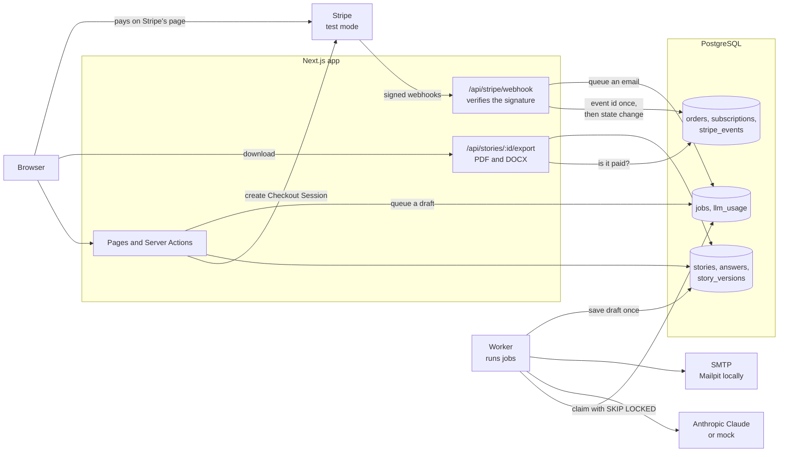
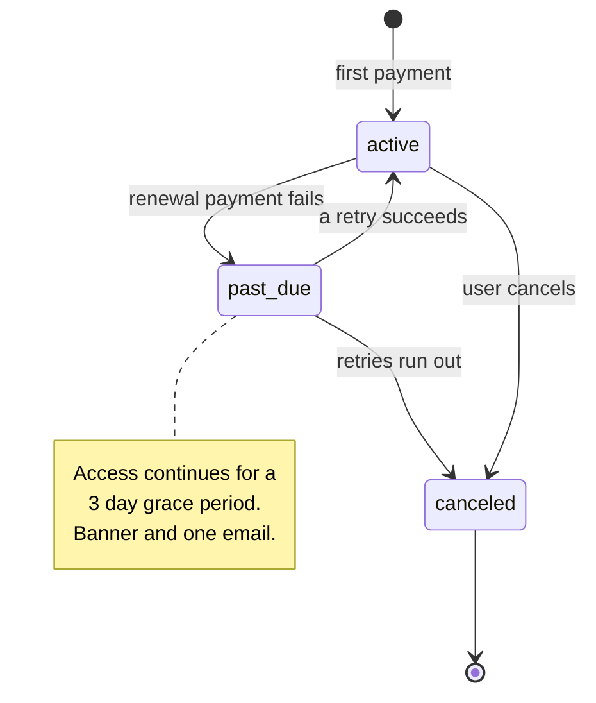
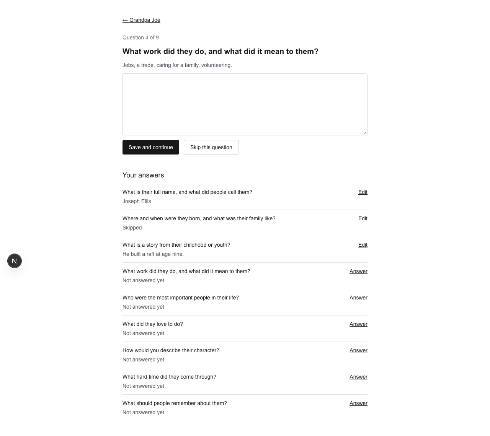
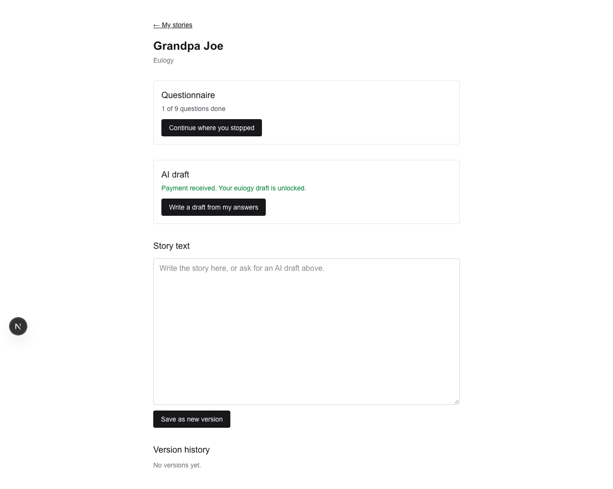
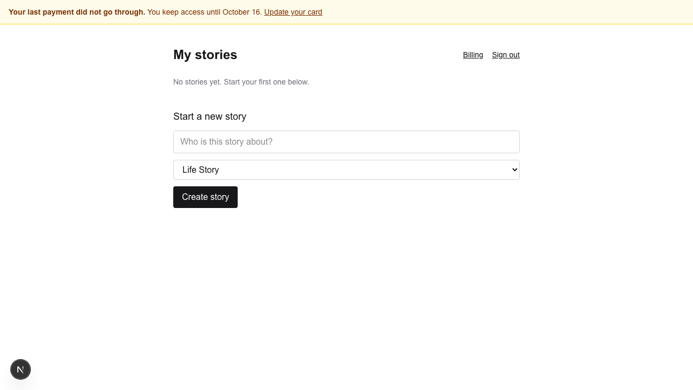
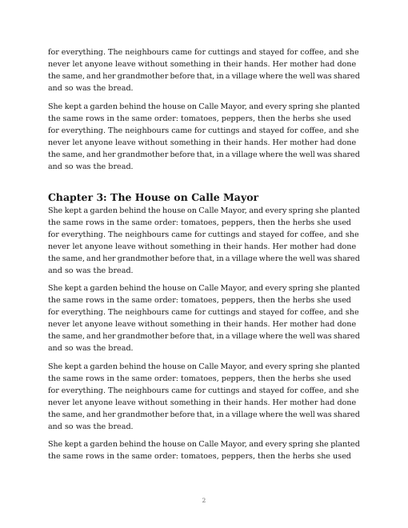

# StoryKeep

A small but real app. A user answers a short questionnaire about a person's
life, an LLM drafts a "Life Story" or a eulogy, the user edits it, and
downloads it as **PDF** and **DOCX**. Payment is by Stripe: a one-time $9
purchase or a $7/month subscription.

I built it in one weekend to learn and prove three things: **Stripe billing
with dunning**, **server-side PDF and DOCX generation**, and **LLM calls in
idempotent background jobs**. Stripe runs in test mode only.

**Live demo:** https://storykeep-one.vercel.app (test card `4242 4242 4242 4242`,
any future date, any CVC)

Every claim below links to evidence: a test, a log or a screenshot.

## What it proves

| Topic | What is built | Evidence |
|---|---|---|
| Access control | A user can read only their own stories. Another user's story answers 404. | [m1-access-control.md](docs/evidence/m1-access-control.md) |
| Version history | Answers and story text are append-only. Any version can be restored. | [m2-questionnaire-versions.md](docs/evidence/m2-questionnaire-versions.md) |
| Background jobs | LLM drafts run in a Postgres job queue with retries and backoff. A retried job never creates a duplicate. Daily cost cap. | [m3-llm-jobs.md](docs/evidence/m3-llm-jobs.md) |
| Replay-safe webhooks | Stripe signature check, plus an events table that makes a replayed event a no-op. | [m4-stripe-one-time.md](docs/evidence/m4-stripe-one-time.md) |
| Dunning | `active -> past_due -> canceled`, a 3 day grace period, a banner and an email. Run with Stripe test clocks. Out-of-order webhooks end in the right state. | [dunning.md](docs/evidence/dunning.md) |
| PDF and DOCX | Built on the server from one content model. Page numbers, no orphan headings, accents and symbols. | [m6-export.md](docs/evidence/m6-export.md), [samples](docs/evidence/samples/) |
| Deploy | Vercel and Neon. The job queue runs with no worker process. | [DEPLOY.md](docs/DEPLOY.md) |

A short list of exactly what I can and cannot claim is in
[docs/FINAL_REPORT.md](docs/FINAL_REPORT.md).

## Architecture



Three ideas hold the design together:

1. **The database is the source of truth, and webhooks are the only writer
   of billing state.** The browser is never trusted. "Paid" means a row that a
   verified Stripe webhook wrote.
2. **Everything can happen twice.** Stripe may send an event twice. A job may
   run twice. So each side effect has a unique key in the database, and the
   second attempt changes nothing.
3. **Slow work leaves the request.** The web request only inserts a job row.
   A worker does the slow part, so a draft still arrives if the tab is closed.

The subscription state machine:



## Stack

| Part | Choice | Why |
|---|---|---|
| App | Next.js 16 (App Router), TypeScript, Tailwind | |
| Database | PostgreSQL, Drizzle ORM | Drizzle reads like SQL, and the design depends on unique constraints and `ON CONFLICT`. |
| Auth | Auth.js, email and password | Simple, and easy to drive in browser tests. |
| Jobs | A Postgres table as the queue | No extra service. About 150 lines that I can explain. |
| LLM | Anthropic Claude behind an interface, with a mock | Tests are free and run offline. |
| PDF | `@react-pdf/renderer` | Pure Node, so it runs in a serverless function. |
| DOCX | `docx` | Real Word structure: heading styles, footer, sections. |
| Tests | Vitest with a real Postgres, Playwright | The database enforces the rules, so the tests use a real one. |

The reasons, trade-offs and "what broke first" for each milestone are in
[docs/DECISIONS.md](docs/DECISIONS.md).

## Setup (under 10 minutes)

You need Docker, Node 20 or newer, and pnpm.

```bash
git clone https://github.com/samilabud/storykeep.git && cd storykeep
pnpm install
cp .env.example .env.local
# In .env.local set AUTH_SECRET to the output of:  openssl rand -base64 32
docker compose up -d        # Postgres on 5440, test Postgres on 5441, Mailpit on 8025
pnpm db:migrate
pnpm dev                    # http://localhost:3100
pnpm worker                 # second terminal: runs background jobs
```

This is enough to register, fill the questionnaire and get drafts. The LLM is
a mock by default (`LLM_PROVIDER=mock`), so no API key is needed.

Measured from a fresh clone on my machine: install, migrate, 191 tests and a
production build took 34 seconds (Docker images and the pnpm cache were
already present).

**To take test payments** (optional):

1. Put a Stripe **test** key in `.env.local`: `STRIPE_SECRET_KEY=sk_test_...`.
   The app refuses any key that does not start with `sk_test_`.
2. Run `pnpm stripe:listen` in a third terminal. Copy the `whsec_...` value it
   prints into `STRIPE_WEBHOOK_SECRET` and restart `pnpm dev`.
3. Pay with the test card `4242 4242 4242 4242`.

**To use the real model** (optional): set `LLM_PROVIDER=anthropic` and
`ANTHROPIC_API_KEY`. The default model is Claude Haiku, about 0.04 cents per
draft.

## Commands

| Command | What it does |
|---|---|
| `pnpm dev` | Run the app on port 3100 |
| `pnpm worker` | Run the background job worker |
| `pnpm test` | 191 unit and integration tests against the test database |
| `pnpm test:e2e` | Playwright browser tests (no Stripe needed) |
| `pnpm stripe:listen` | Forward Stripe test webhooks to the app |
| `pnpm test:e2e:stripe` | A real test-mode payment and subscription in a browser |
| `pnpm test:e2e:dunning` | Failed renewals with Stripe test clocks, about 3 minutes |
| `pnpm test:e2e:deployed` | Smoke test against a deployed site (`E2E_BASE_URL=...`) |
| `pnpm samples` | Write sample PDF and DOCX files to `docs/evidence/samples` |
| `pnpm llm:smoke` | One real Anthropic API call (needs a key) |
| `pnpm typecheck` / `pnpm lint` | Static checks |
| `pnpm db:generate` / `pnpm db:migrate` | Create and apply migrations |

CI runs lint, typecheck, all 191 tests against Postgres, and a production
build on every push: [.github/workflows/ci.yml](.github/workflows/ci.yml).

## Project layout

```
src/
  app/            pages, Server Actions and API routes
  auth/           Auth.js config and the access guards
  billing/        Stripe: checkout, webhook handlers, state machine, entitlement
  jobs/           the queue, the worker loop and the job handlers
  llm/            provider interface, Anthropic and mock providers, cost cap
  export/         content model, PDF renderer, DOCX renderer
  questionnaire/  questions and append-only answers
  stories/        stories, versions and draft requests
  db/             Drizzle schema and client
tests/
  unit/           pure logic: state machine, content model, LLM mapping
  integration/    real Postgres: access, jobs, webhooks, exports
  e2e/            Playwright, including real Stripe test mode
docs/
  DECISIONS.md        what was chosen and why, per milestone
  INTERVIEW_NOTES.md  how I explain each part
  FINAL_REPORT.md     what is proven and what is not
  DEPLOY.md           Vercel and Neon
  evidence/           test logs, screenshots, sample files
```

## Screenshots

| | |
|---|---|
|  |  |
| The questionnaire resumes where the user stopped | After the webhook: payment received |
|  |  |
| A failed renewal: banner during the grace period | A page of the exported PDF |

## Limits

This is a learning project, not a product. Known gaps, all written down in
[docs/DECISIONS.md](docs/DECISIONS.md):

- Stripe is in test mode only. No tax, no proration, no plan changes.
- No nightly job compares the database with Stripe.
- The daily LLM cost cap is per user, and it is a soft cap.
- No password reset, no email verification, no rate limit on login.
- On Vercel a job must finish inside one function run, and a retry waits for
  the next trigger.
- The Word file was checked in LibreOffice, not in Microsoft Word.
